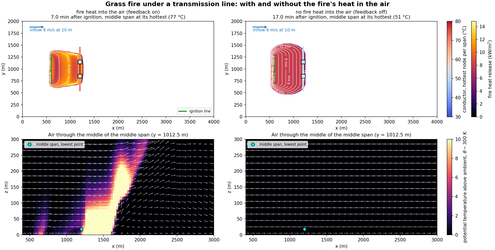
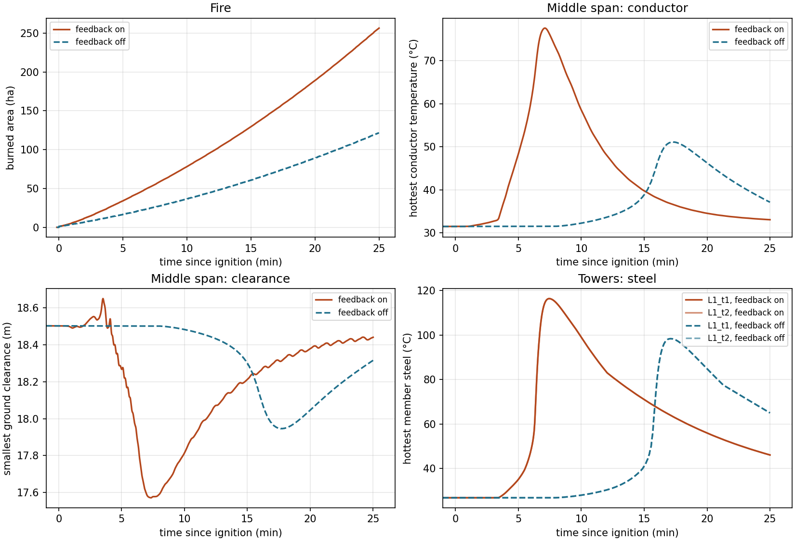

.. _sec:FireUnderLine:

Benchmark: a grass fire under a transmission line
=================================================

This page describes a benchmark of the fire-to-structures coupling: a grass fire that runs under a
transmission line, with the conductors' and the towers' temperatures followed through the fire's passage.
The case runs twice, with and without the fire's heat put into the air, so that the comparison shows what the
two-way fire-atmosphere coupling changes for the line. The case is in ``Structures/Exec/FireUnderLine``
(its ``README.md`` gives the steps to run it).

The benchmark is a demonstration on a simple configuration, not a validation against measurements: no
measured data of a fire under a line are used. Each model it joins is checked on its own elsewhere. The
conductor's heat balance reproduces the sample calculations of IEEE Std 738-2023 (unit test
``LineThermal.TheTermsMatchIEEE7382023sSampleCalculations``). The steel heating reproduces the unprotected-beam
example of the JRC report EUR 26698 EN (unit test ``TowerThermal.TheJRCWorkedExampleReachesItsCriticalTemperature``).
Both are described in :ref:`sec:Conductors`.

Configuration
-------------

**Flow.** A neutral boundary layer over flat ground enters through the upwind face as a log law,

.. math::
   :label: ful-loglaw

   u(z) = \frac{u_*}{\kappa} \ln \frac{\min(z, z_i) + z_0}{z_0} , \qquad
   u_* = \frac{\kappa U_{10}}{\ln \left( (10\,\mathrm{m} + z_0) / z_0 \right)} ,

with :math:`U_{10} = 6` m/s the wind speed at 10 m, :math:`z_0 = 0.05` m the roughness length,
:math:`\kappa = 0.41` the von Kármán constant, :math:`z_i = 400` m the base of a capping inversion (the
potential temperature rises by 0.01 K/m above it), and :math:`u_* = 0.464` m/s the friction velocity. The
inflow profile is given at every cell centre, so each inflow cell takes the log law's value there. The
turbulence is the k-equation RANS closure (:ref:`RANS`); the inflow's turbulent kinetic energy is the closure's
neutral wall value :math:`u_*^2 / (c_\mu^0)^2 = 0.70` m\ :sup:`2`/s\ :sup:`2` with ERF's
:math:`c_\mu^0 = 0.5562`. The domain is 4000 m along the wind, 2000 m across it (periodic) and 600 m high, on
25 m × 25 m × 10 m cells, anelastic with MidPoint time stepping and the FFT pressure solve, at a fixed step of
0.5 s. The summed advective Courant number is 0.2 in the inflow and reaches 0.83 in the plume, where the
vertical velocity reaches 11 m/s (largest values in the plotfiles, written every 60 s).

**Fire.** Tall grass (Anderson fuel model 3) at 6 % dead fine-fuel moisture covers the ground, on 5 m fire
cells. Rothermel's rate drives FLARE's level-set front. The fire samples the wind at 6.1 m and brings it to
mid-flame height with Andrews' wind adjustment factor (:ref:`sec:FireCouplingNative`). A 600 m line is lit at :math:`t = 600` s, 600 m upwind of the line and
across the wind. The fire is coupled to the air with a lag of one step: its sensible and latent heat fluxes
enter the air above it, multiplied by ``erf.fire.fire_atm_feedback``.

**Line.** A line of Drake ACSR conductor runs across the wind at :math:`x = 1200` m: dead ends at
:math:`y = 550` m and 1450 m, and two 30 m lattice towers (310 members each) at :math:`y = 850` m and
1150 m. The three spans are 300 m long, strung to 20 kN on 2.5 m insulator strings, and carry 600 A. Each
conductor node's temperature :math:`T_n` follows the heat balance of IEEE Std 738-2023,

.. math::
   :label: ful-balance

   m c_p \frac{dT_n}{dt} = q_J(T_n) + q_{f,n} - q_c(T_n, T_{a,n}, V_n, \phi_n) - q_r(T_n, T_{s,n}) ,

where :math:`m c_p` is the conductor's heat capacity per unit length, :math:`q_J` the Joule heating,
:math:`q_{f,n}` the fire's radiation absorbed by the conductor, :math:`q_c` the convective loss to the air at
temperature :math:`T_{a,n}`, speed :math:`V_n` and angle :math:`\phi_n` to the conductor, and :math:`q_r` the
radiative loss to surroundings at :math:`T_{s,n}`. Solar heating is off (``conductors.thermal.solar_flux``
keeps its default, 0). The span's length follows the
thermal strain, so it sags as it heats. Every tower member heats as unprotected steel (EN 1993-1-2 lumped
heating) from the same fire radiation and the air around it. The tower's frame is rebuilt with the reduced
stiffness and strength when they change by more than 1 %. :ref:`sec:Conductors` gives the terms and their
equation numbers.

**The pair.** Both runs share a 590 s spin-up of the flow and the line, then restart from the same
checkpoint:

- *feedback on* (``erf.fire.fire_atm_feedback = 1``): the fire's heat enters the air, and the warmed air
  changes the wind the fire and the line see;
- *feedback off* (``= 0``): the air never sees the fire. The fire spreads in the undisturbed wind, and the
  conductors and towers are heated by its radiation alone.

Results
-------

The runs below use MoorDyn-C 2.7.1 on 4 ranks. :numref:`fig-ful-snap` shows each run when its middle span is
hottest, and :numref:`fig-ful-series` the fire, the middle span and the towers through the 25 minutes of fire.

.. _fig-ful-snap:

   Each run when its middle span is hottest. Top: the fire's heat release and arrival times in plan view, the
   line's spans coloured by their hottest conductor node, the towers as squares. Bottom: the potential
   temperature above ambient in the vertical plane through the middle of the middle span, with the wind.

.. _fig-ful-series:

   The burned area, the middle span's hottest conductor node and smallest ground clearance, and the towers'
   hottest member, against the time since ignition.

.. list-table:: The two runs (``compare_runs.py``)
   :header-rows: 1
   :widths: 52 24 24

   * - Quantity
     - Feedback on
     - Feedback off
   * - Mean head rate of spread, first 10 min after ignition
     - **1.58 m/s**
     - 0.65 m/s
   * - Fire reaches the line (centre of the middle span)
     - 6.3 min
     - 15.8 min
   * - Middle span: hottest conductor node (31.5 °C before the fire)
     - **77.5 °C** at 7.1 min
     - 51.1 °C at 17.3 min
   * - Middle span: largest fire irradiance on the conductor
     - 48.8 kW/m²
     - 24.7 kW/m²
   * - Middle span: largest added sag; smallest ground clearance (18.50 m before)
     - 0.93 m; 17.57 m
     - 0.56 m; 17.95 m
   * - Towers: hottest member steel
     - **116 °C**
     - 98 °C
   * - Towers: smallest stiffness factor :math:`k_E`; frame rebuilds
     - 0.990; 2
     - 1.000; 0
   * - Towers: largest member utilisation
     - 0.072
     - 0.060

**What the feedback changes.** With the fire's heat in the air, the head spreads 2.5 times faster: the warmed
air changes the wind the fire samples. The fire reaches the line 9.5 minutes earlier. The plume also carries hot
air downwind of the front: the air at the middle span's hottest node is at 60 °C to 69 °C from 3.7 min, before
the front arrives, and has warmed the conductor to about 56 °C when the radiation peaks (41 kW/m² at 6.3 min).
Air and radiation together take the conductor to 77.5 °C. Without the feedback the air at the line stays at
26.7 °C, and the slower, less intense front heats the conductor by radiation alone, to 51.1 °C. The towers follow
the same pattern. All members stay far below their capacities.

**What it shows for the coupling.** One-way coupling (feedback off) misses both the faster fire and the hot air
at the line. In this case its conductor temperature rise above the pre-fire value is 57 % smaller (19.6 K
against 46.0 K) and its added sag 40 % smaller, at this resolution.

**An independent check of the peaks.** A separate script that integrates Eq. :eq:`ful-balance` for one lumped
conductor, driven by the logged irradiance, air temperature and wind of the middle span, gives peaks of 77.6 °C
(feedback on) and 51.1 °C (off), against 77.5 °C and 51.1 °C logged. The conductor's time constant at the peaks
is 175 s and 241 s, comparable to the time the radiation lasts at the line: the steady temperature at the
largest irradiance would be 150 °C and 96 °C.

**The wind delivered.** After the 590 s spin-up the wind at the line is 4.7 m/s at 5 m and 5.9 m/s at 15 m, about
10 % below the inflow's log law, as the RANS flow adjusts over the 1200 m from the inflow face.

Limitations
-----------

- *Resolution.* The atmosphere has 25 m cells and the fire 5 m cells. The plume near the ground, one or two
  atmosphere cells wide, and the head's acceleration under it are resolved coarsely, so the difference between
  the two runs' spread rates is a result at this resolution, not a converged one. A sensitivity study (time
  step, mesh, the height at which the fire samples the wind, domain length) is not part of the benchmark.
- *The fire's wind.* With feedback on, the fire samples the wind at 6.1 m, inside the first atmosphere cell,
  which the fire heats and which carries the fire's own inflow. The wind adjustment factor, derived for a
  logarithmic profile, is applied to that induced wind.
- *The conductor's peak.* The conductor's time constant (a few minutes) is comparable to the time the fire's
  radiation lasts at the line, so the peak temperature depends on how fast the fire passes, not only on how
  strong it is.
- *RANS.* The k-equation RANS gives a mean flow. The gusts a large-eddy simulation would carry, and the
  fluctuations of the conductor's convective cooling with them, are not represented.
- *Point-source radiation.* The fire's radiation reaching each conductor node and tower member is summed from
  point sources at the burning fire cells, with an irradiance falling with the square of the distance; flame
  shape and view factors are not modelled (:ref:`sec:Conductors`).
- *Anderson fuel model 3 everywhere*, with constant moisture; no terrain, no structures other than the line.
- *The MoorDyn stub* used by the CTest hangs each span as a parabola, so its sag differs from MoorDyn-C's; the
  numbers above come from MoorDyn-C.

References
----------

* Anderson, H. E. (1982). *Aids to determining fuel models for estimating fire behavior.* USDA Forest Service
  General Technical Report INT-122. https://www.fs.usda.gov/rm/pubs_int/int_gtr122.pdf
* Rothermel, R. C. (1972). *A mathematical model for predicting fire spread in wildland fuels.* USDA Forest
  Service Research Paper INT-115. https://www.fs.usda.gov/rm/pubs_int/int_rp115.pdf
* Andrews, P. L. (2012). *Modeling wind adjustment factor and midflame wind speed for Rothermel's surface fire
  spread model.* USDA Forest Service General Technical Report RMRS-GTR-266.
  https://www.fs.usda.gov/rm/pubs/rmrs_gtr266.pdf
* IEEE Std 738-2023, *IEEE Standard for Calculating the Current-Temperature Relationship of Bare Overhead
  Conductors*. doi:10.1109/IEEESTD.2023.10382442.
* Vassart, O., Zhao, B., Cajot, L. G., Robert, F., Meyer, U. and Frangi, A. (2014). *Eurocodes: Background &
  Applications. Structural Fire Design. Worked examples*. M. Poljanšek, B. Nikolova, L. Sousa, S. Dimova and
  A. Pinto (eds.), JRC Science and Policy Report EUR 26698 EN. Publications Office of the European Union,
  Luxembourg. doi:10.2788/85432. Open access (reproduction authorised with acknowledgement).
